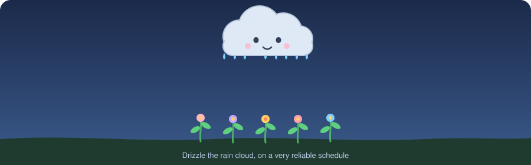

<p align="center">
  
</p>

<p align="center">
  
</p>

# tiny-robot-garden

A tiny robot, a sleepy rain cloud, a slow snail and one very bright firefly share a small garden at night. Everything you see here is hand-written SVG with built-in SMIL animation. No images, no scripts, no emoji.

<p align="center">
  
</p>

## Meet the cast

<p align="center">
  
</p>

| Character | Role | Quirk |
|-----------|------|-------|
| **Bolt** | Head gardener | Blinks every four seconds and waves hello with the left arm |
| **Pip** | Soil inspector | Moves only when nobody is watching, which is always |
| **Glim** | Night lantern | Flies a figure-eight loop and pulses with light |
| **Drizzle** | Weather department | Rains on a strict eight second schedule |

<p align="center">
  
</p>

## The watering cycle

<p align="center">
  
</p>

Each flower starts as a seed-sized sprout, grows while the rain falls, then resets so the cycle can start again. The delays between flowers create a small wave across the garden.

<p align="center">
  
</p>

## How it works

- Every animation uses SMIL (`animate`, `animateTransform`, `animateMotion`), so it runs on GitHub when the file is embedded with an `img` tag.
- Characters are built from basic shapes: rectangles, ellipses, circles and a few curves.
- Reusable parts such as the sprout are defined once in `defs` and placed with `use`.
- Colors are fixed, so the scenes look the same in light and dark mode.

## Project layout

```text
tiny-robot-garden/
  README.md
  assets/
    hero.svg         banner scene with Bolt and the garden
    characters.svg   character sheet: Bolt, Pip, Glim
    drizzle.svg      rain cloud and growing flowers
    divider.svg      vine that draws itself
```

## Reuse

Copy any SVG from `assets/` into your own project. Change the colors, move the characters, add a new friend to the garden.

<p align="center">
  
</p>
